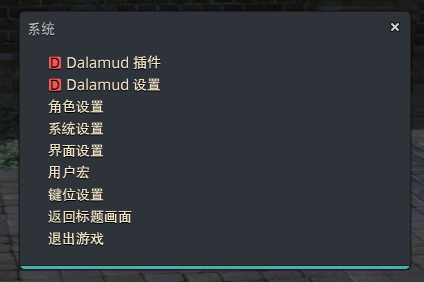
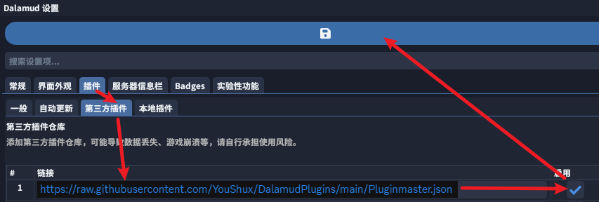
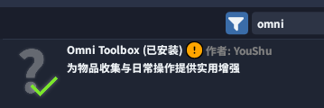
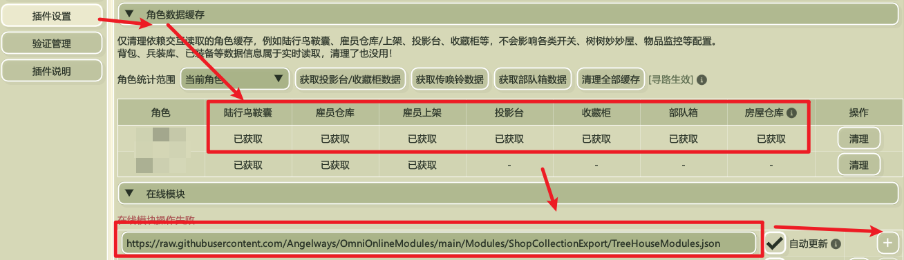
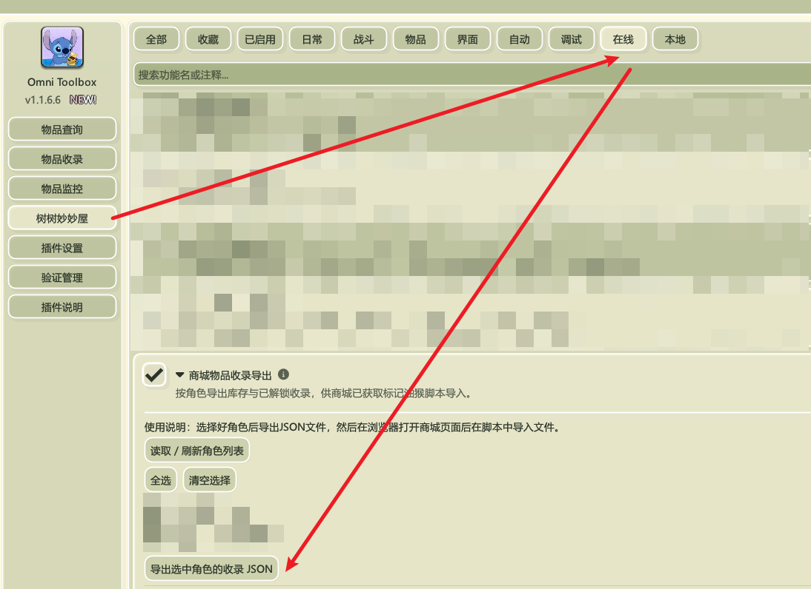

# 商城道具收录图文教程

本教程说明如何安装 Omni Toolbox 和“商城物品收录导出”在线模块，将游戏内收录导出为 JSON，再导入浏览器脚本，在 FF14 道具商城查看各角色的获取状态。

已经安装启动器和 Omni Toolbox 的读者，可以直接从[第 5 步](#5-读取角色缓存并添加在线模块)开始；已经导出收录文件的读者，可以直接查看[第 7 步](#7-在浏览器安装脚本并导入收录)。

## 开始前

需要准备能够加载 Dalamud 插件的国服启动器，以及安装了 [Tampermonkey](https://www.tampermonkey.net/) 的桌面浏览器。主要使用 Chrome 验证。

本教程对应网站优化脚本 **3.2.0**、商城物品收录导出模块 **1.2.3**；模块要求 Omni Toolbox **1.1.6.6 或更新版本**。截图用于说明入口位置，界面可能随插件更新有所变化。

整体流程：**读取角色库存缓存 → 添加并启用在线模块 → 手动导出 JSON → 在商城导入 JSON 并选择角色**。

## 1 下载并使用启动器

打开 [FFXIVQuickLauncher 发布页面](https://github.com/AtmoOmen/FFXIVQuickLauncher/releases)，下载启动器并使用它启动游戏。

如果没有特殊需要，可以选择以 `win-Portable.zip` 结尾的便携包，例如 `XIVLauncherCN-win-Portable.zip`。解压后按启动器说明完成设置。

## 2 打开 Dalamud 插件

进入游戏后，按 **Esc** 打开主菜单，点击 **Dalamud 插件**。



## 3 添加第三方插件仓库

在插件安装器中打开设置，进入 **插件 → 第三方插件**，添加以下仓库地址，勾选启用并保存：

```text
https://raw.githubusercontent.com/YouShux/DalamudPlugins/main/Pluginmaster.json
```



## 4 安装 Omni Toolbox

返回插件安装器，搜索 `Omni` 或 `Omni Toolbox`，找到插件并安装。



## 5 读取角色缓存并添加在线模块

打开 **Omni Toolbox → 插件设置**，按插件指引读取需要统计的角色数据缓存。未读取或已经过期的库存快照，可能导致收录不完整。

需要统计其他角色时，应分别登录这些角色并更新相关缓存；鞍囊、雇员、投影台、收藏柜等容器按 Omni 插件的提示读取。需要关联房屋仓库数量时，再读取对应房库快照。

在同一设置页的 **在线模块** 中添加下面的完整订阅地址，并点击右侧的 **＋**：

```text
https://raw.githubusercontent.com/Angelways/OmniOnlineModules/main/Modules/ShopCollectionExport/TreeHouseModules.json
```

请复制整行清单地址。仓库首页地址与 DLL 文件地址不能代替这个订阅地址。



## 6 启用模块并导出收录

进入侧边栏 **树树妙妙屋 → 在线**，找到 **商城物品收录导出**，勾选启用。

1. 等待模块读取角色列表；需要重新读取时，点击 **读取 / 刷新角色列表**。
2. 勾选需要导出的角色。
3. 点击 **导出选中角色的收录 JSON**。采集期间保持当前角色登录，等待“导出成功”提示。
4. 在角色列表下方点击 **打开导出文件夹**，找到 `OmniShopOwned.json`。也可以通过 **选择文件夹…** 或手动输入路径设置导出位置，再使用 **复制地址** 定位文件。

默认导出位置是 Omni 当前配置目录下的 `Exports` 文件夹。



启用模块和登录只会自动读取角色列表，**不会自动导出**。采集时退出或切换角色会中止当前采集；请保持登录直至完成，再切换角色。

## 7 在浏览器安装脚本并导入收录

1. 在桌面浏览器安装 [Tampermonkey](https://www.tampermonkey.net/)。
2. 打开 [一系列 FF14 官网与商城功能优化安装页面](https://greasyfork.org/zh-CN/scripts/599251)，点击安装并按 Tampermonkey 提示完成。已经安装合集的用户可以直接更新。
3. 打开 [FF14 道具商城](https://qu.sdo.com/tools-shop)，刷新页面。
4. 展开 **商城道具收录** 独立窗口，点击 **导入收录 JSON**，选择刚才导出的 `OmniShopOwned.json`。
5. 在窗口的 **角色** 下拉框中选择需要查看的角色，等待商品标记更新。

直升包、永结同心、染剂分类不显示获取状态，也不进行筛选。

新增商品未被识别时，可以点击 **更新商城清单**；这个操作只更新商品对应关系，不更新角色库存。角色数据变化后，仍需在游戏中重新读取相关缓存、手动导出，再导入浏览器。

## 常见问题

### 游戏里没有角色列表或数据不完整

确认已登录游戏并更新 Omni 对应角色的缓存，然后点击模块中的 **读取 / 刷新角色列表**。永久解锁需要该角色实际登录并手动导出；浏览器提示“仅依据库存快照”时，说明该角色尚未采集解锁数据。

### 浏览器里没有窗口或标记

确认 Tampermonkey 和合集已启用，正在访问 FF14 桌面商城，并且已刷新页面。Chrome 如果提示脚本无法运行，请按扩展提示开启“允许运行用户脚本”。再检查总配置中的总开关、“商城道具收录”以及图片、名称标记开关。

没有窗口与没有持有匹配是不同情况：窗口存在但某个商品没有标记时，先确认选对了角色、导入文件足够新，并且商品不在上述排除分类中。

### 导入失败

确认选的是 `OmniShopOwned.json`，不是原始库存缓存或模块订阅清单。不要改写导出文件的结构；损坏的文件请重新导出。单个导入文件上限为 **20 MB**，超过时可减少导出角色。

### 明明拥有商品却没有标记

先检查角色和解锁采集时间，再刷新相关容器缓存、重新导出并导入。雇员上架物品和部队仓库不计入；共享房屋的关联房库数量另列。新增商品还可以尝试更新商城清单。

### 更新后是否需要重新安装

网站脚本在原合集上更新即可。在线模块通过 Omni 在线模块设置刷新订阅获取更新，按 Omni 提示完成应用。模块仍使用原配置与解锁快照；不需要为脚本更新重新安装游戏内模块。

导出的角色和库存数据只保存在本地，浏览器脚本不会上传收录文件。“更新商城清单”只匿名读取官方公开商品接口。反馈问题时请提供页面、版本和复现步骤，避免公开上传个人收录 JSON。

## 相关链接

- [网站脚本安装](https://greasyfork.org/zh-CN/scripts/599251)
- [问题反馈](https://github.com/Angelways/ff14-official-mall-enhancements/issues)
